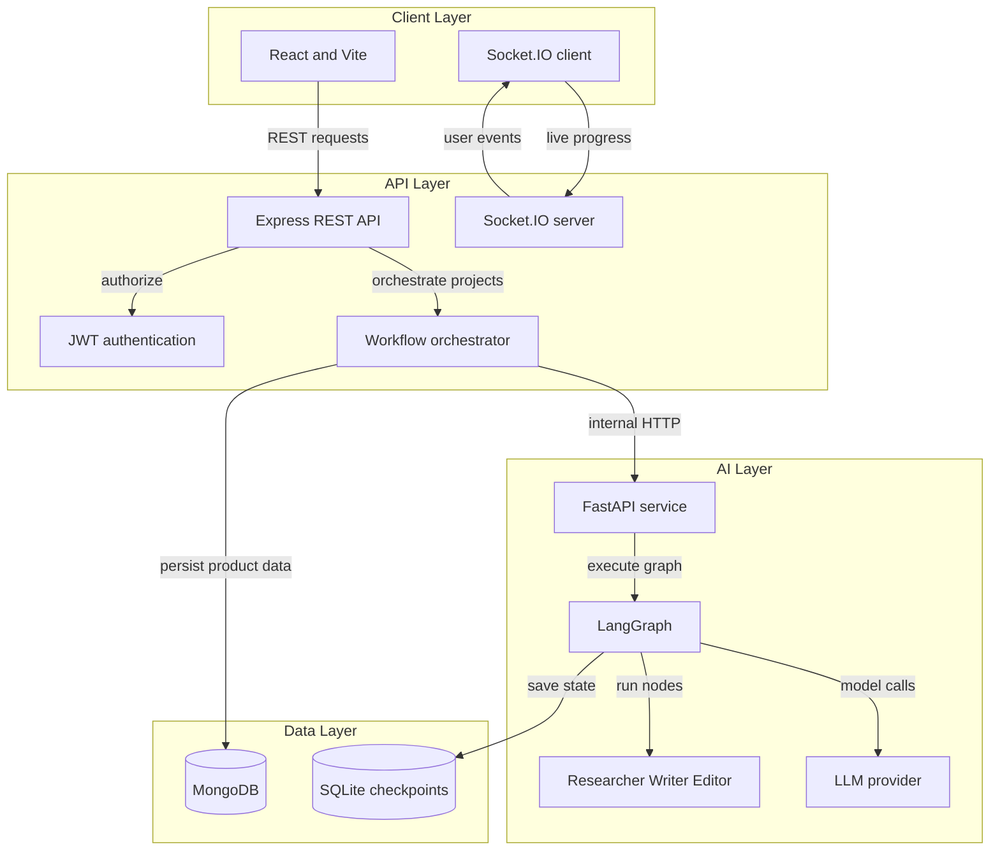
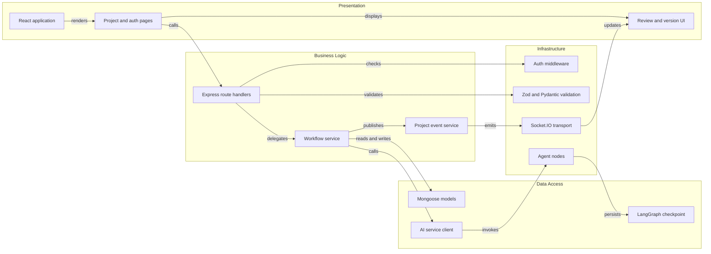

# Architecture Diagram

BlogFlow AI is a three-service human-in-the-loop blog generation platform. The React client talks to an Express API, which persists product data in MongoDB and coordinates a checkpointed FastAPI and LangGraph AI workflow.

## Application Architecture

<!-- mermaid-checked: no \n, no em-dash/en-dash, no {} in labels, subgraphs are id["label"], arrows are -->|"label"|, all subgraphs closed by end, ids unique -->

### Technology Stack Summary

| Layer | Technology | Version | Purpose |
|---|---|---|---|
| Client | React | 19 | User interface and routing |
| Client build | Vite | 8 | Development and production build |
| Client styling | Tailwind CSS | 4 | Utility-first presentation |
| Client realtime | Socket.IO Client | 4 | Live workflow events |
| API | Node.js and Express | Node 20+, Express 5 | REST boundary and orchestration |
| API persistence | MongoDB and Mongoose | Mongoose 9 | Users, projects, tokens, and versions |
| API realtime | Socket.IO | 4 | Private user progress rooms |
| AI API | Python and FastAPI | Python 3.10+, FastAPI 0.110+ | Internal workflow endpoints |
| Workflow | LangGraph | 0.6+ | Stateful graph execution and interrupts |
| Checkpointer | SQLite | Local durable file | Paused workflow state |
| LLM integration | LangChain | 0.3+ | Provider-independent model factory |

### Data Storage & External Services

MongoDB is the source of truth for users, rotating refresh tokens, projects, and article versions. The AI service uses SQLite through `SqliteSaver` to persist LangGraph checkpoints, including the selected model and pending human review. Express calls the AI service over internal HTTP using an optional shared key. The AI service calls a configured Groq, OpenAI, or Anthropic-compatible model provider.

### Key Architectural Decisions

- The browser uses Express as its only application boundary.
- The MongoDB project ID is also the AI workflow thread ID.
- Human review uses LangGraph interrupts and durable checkpoints.

## Component Relationships

<!-- mermaid-checked: no \n, no em-dash/en-dash, no {} in labels, subgraphs are id["label"], arrows are -->|"label"|, all subgraphs closed by end, ids unique -->

### Component Inventory

| Component | Layer | Type | Responsibility |
|---|---|---|---|
| React application | Presentation | React root | Routes public and authenticated screens |
| Project and auth pages | Presentation | Pages | Login, registration, project list, and project detail flows |
| Review and version UI | Presentation | Components | Shows progress, human decisions, Markdown, diffs, and history |
| Express route handlers | Business Logic | REST routes | Exposes authentication and project operations |
| Workflow service | Business Logic | Orchestrator | Claims projects, calls AI, applies results, and handles failures |
| Project event service | Business Logic | Event publisher | Sends owner-scoped workflow events |
| Mongoose models | Data Access | MongoDB models | Persists users, tokens, projects, and versions |
| AI service client | Data Access | HTTP client | Calls start, status, resume, and retry endpoints |
| LangGraph checkpoint | Data Access | SQLite checkpointer | Saves resumable graph state |
| Auth middleware | Infrastructure | Express middleware | Validates access tokens and scopes requests |
| Zod and Pydantic validation | Infrastructure | Validation layer | Rejects malformed browser and internal requests |
| Socket.IO transport | Infrastructure | Realtime transport | Authenticates sockets and delivers project events |
| Agent nodes | Infrastructure | LangGraph nodes | Runs Researcher, Writer, and Editor prompts |
