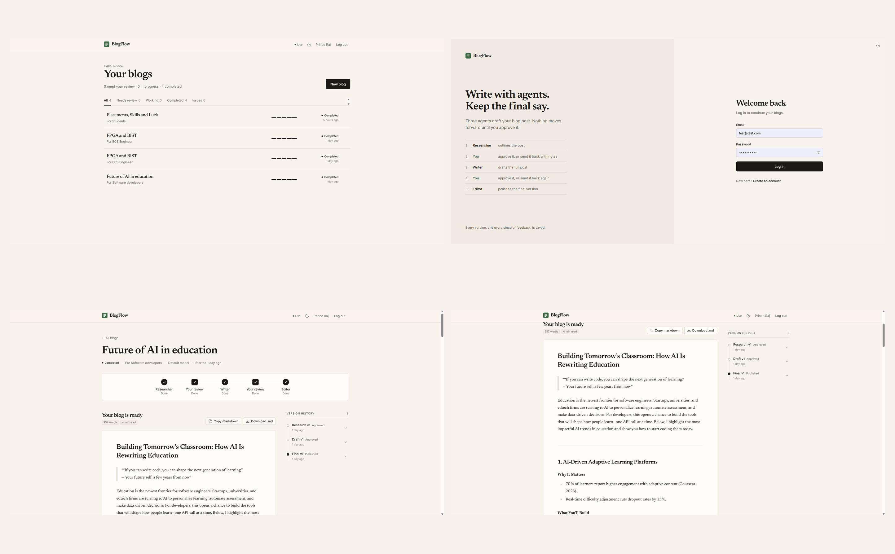
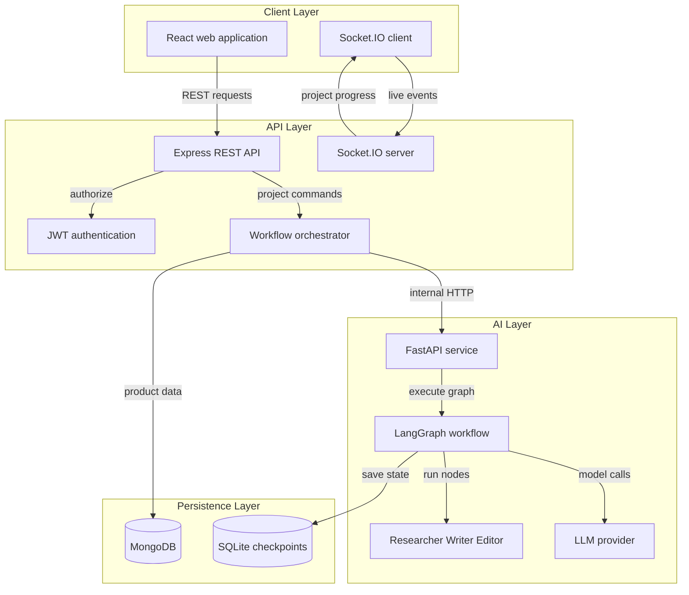
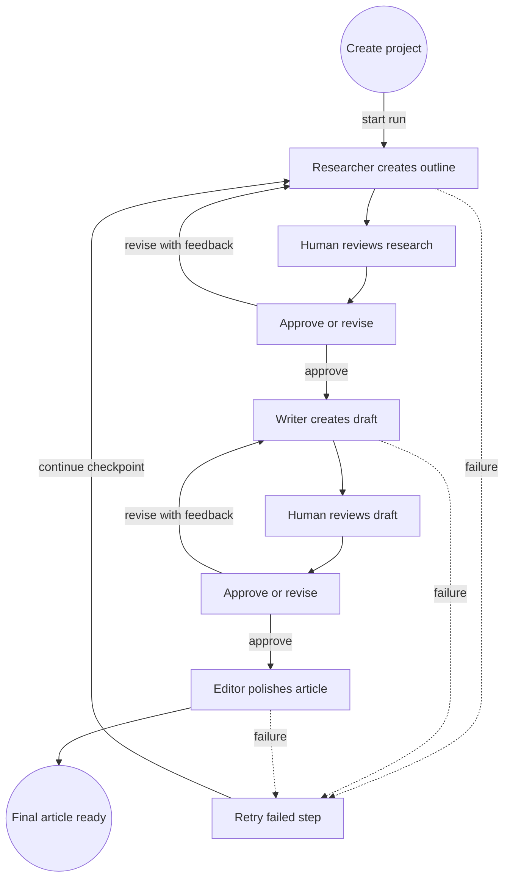
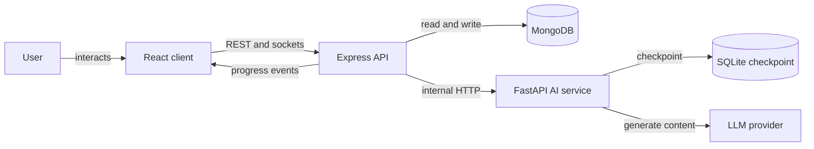

# BlogFlow AI
## Screenshots



BlogFlow AI is a human-in-the-loop, multi-agent blog studio. A user creates a blog project, the AI Researcher creates an outline, the Writer creates a draft, and the Editor produces the final polished article. A person reviews and can approve or send back the research and draft before the workflow continues.

## Features

- React dashboard for authentication, projects, reviews, diffs, and version history.
- Researcher, Writer, and Editor agents coordinated by LangGraph.
- Human approval or revision feedback after research and after drafting.
- MongoDB persistence for users, projects, refresh tokens, and article versions.
- SQLite checkpoints for resumable AI workflows.
- Socket.IO progress events with polling fallback.
- Retry and synchronization flows for interrupted or failed AI work.
- JWT access tokens, rotating HTTP-only refresh tokens, ownership checks, validation, rate limits, Helmet, and explicit CORS.

## Architecture

The repository contains three cooperating services:

| Service | Responsibility | Default address |
|---|---|---|
| `client/` | React 19, Vite, Tailwind UI, REST client, Socket.IO client | `http://localhost:5173` |
| `server/` | Express 5 API, authentication, MongoDB, orchestration, Socket.IO | `http://localhost:4000` |
| `ai-service/` | FastAPI, LangGraph, checkpoints, LLM provider integration | `http://localhost:8000` |
| MongoDB | Users, refresh tokens, projects, and versions | `mongodb://127.0.0.1:27017/blogflow` |
| SQLite | LangGraph workflow checkpoints | `ai-service/checkpoints.sqlite` |

<!-- mermaid-checked: no \n, no em-dash/en-dash, no {} in labels, subgraphs are id["label"], arrows are -->|"label"|, all subgraphs closed by end, ids unique -->


### Architectural decisions

1. The Express server is the browser boundary; the browser never calls the AI service directly.
2. The MongoDB project ID is also the LangGraph thread ID, keeping product data and AI state correlated.
3. Long-running model work runs in the background. The server stores each result and publishes progress over Socket.IO.
4. LangGraph interrupts make human review explicit, while SQLite checkpoints allow paused runs to resume after a restart.

## Human-in-the-loop workflow

<!-- mermaid-checked: no \n, no em-dash/en-dash, no {} in labels, subgraphs are id["label"], arrows are -->|"label"|, all subgraphs closed by end, ids unique -->


`MAX_REVISIONS` defaults to three revisions per review stage. Once the limit is reached, the user can approve the content but cannot send that stage back again.

## Request and event flow

<!-- mermaid-checked: no \n, no em-dash/en-dash, no {} in labels, subgraphs are id["label"], arrows are -->|"label"|, all subgraphs closed by end, ids unique -->


1. The client sends a project command to Express.
2. Express authenticates and validates the request, scopes it to the current owner, and creates or claims the project.
3. The workflow service calls FastAPI with the project ID as `thread_id`.
4. FastAPI runs until a human interrupt, a failure, or completion.
5. Express stores the result in MongoDB and emits `step_started`, `step_completed`, or `step_failed`.
6. The client displays the review or final article and can resume or retry the workflow.

## Technology stack

| Area | Technology | Purpose |
|---|---|---|
| Frontend | React 19 | Component-based interface |
| Build and styling | Vite 8 and Tailwind CSS 4 | Development, bundling, and styling |
| Browser realtime | Socket.IO Client 4 | Live workflow events |
| API | Node.js 20+ and Express 5 | REST boundary and orchestration |
| Persistence | MongoDB and Mongoose 9 | Product and version data |
| Authentication | JWT and HTTP-only cookies | Short-lived access and rotating refresh sessions |
| Validation | Zod and Pydantic | Browser and internal API contracts |
| AI API | Python 3.10+ and FastAPI | Internal workflow endpoints |
| Workflow | LangGraph and LangChain | Stateful graph and provider-independent model calls |
| Checkpointing | SQLite and `SqliteSaver` | Durable paused-run state |

Supported LLM providers are `groq`, `openai`, and `anthropic`. The default provider and model are defined in `ai-service/app/llm.py`.

## Repository structure

```text
blogflow-ai/
├── README.md
├── client/
│   ├── package.json
│   └── src/
│       ├── components/       # UI, review, progress, diff, and history
│       ├── lib/              # API, auth, sockets, theme, and helpers
│       ├── pages/            # Auth, projects, and project detail screens
├── server/
│   ├── package.json
│   ├── .env.example
│   ├── src/
│   │   ├── middleware/       # Auth, validation, errors, and rate limits
│   │   ├── models/           # User, token, project, and version models
│   │   ├── routes/           # Auth and project routes
│   │   ├── services/         # AI client, orchestration, tokens, and events
│   │   ├── app.js            # Express configuration
│   │   ├── socket.js         # Authenticated Socket.IO server
│   │   └── index.js          # Startup and MongoDB connection
└── ai-service/
    ├── requirements.txt
    ├── app/
    │   ├── agents.py         # Researcher, Writer, and Editor prompts
    │   ├── graph.py          # Nodes, interrupts, and routing
    │   ├── llm.py            # Provider-independent model factory
    │   ├── main.py           # FastAPI API and checkpoint lifecycle
    │   ├── schemas.py        # Pydantic contracts
    │   └── state.py          # Persisted BlogState
```

## Data model

| MongoDB collection | Purpose |
|---|---|
| `users` | Account identity and password data |
| `refreshtokens` | Rotating refresh sessions and expiry |
| `projects` | Owner, topic, audience, model, status, stage, and revision counters |
| `versions` | Research, draft, and final content with decisions and feedback |

`BlogState` stores topic, audience, selected provider configuration, research, research feedback, draft, draft feedback, revision counts, and `final_blog`. The checkpoint includes the state needed to resume a paused run.

## API overview

### Public API

| Method | Path | Purpose |
|---|---|---|
| `GET` | `/health` | API and MongoDB health |
| `POST` | `/api/auth/register` | Create an account |
| `POST` | `/api/auth/login` | Start a session |
| `POST` | `/api/auth/refresh` | Rotate refresh token and issue access token |
| `POST` | `/api/auth/logout` | Revoke the refresh session |

### Authenticated project API

| Method | Path | Purpose |
|---|---|---|
| `POST` | `/api/projects` | Create project and start workflow |
| `GET` | `/api/projects` | List the current user's projects |
| `GET` | `/api/projects/:id` | Read project state |
| `GET` | `/api/projects/:id/versions` | Read version history |
| `POST` | `/api/projects/:id/resume` | Approve or revise current review |
| `POST` | `/api/projects/:id/retry` | Retry a stalled workflow |
| `POST` | `/api/projects/:id/sync` | Reconcile with AI-service state |
| `DELETE` | `/api/projects/:id` | Delete project and versions |


### Internal AI API

These routes are protected by `X-Internal-Key` when `INTERNAL_API_KEY` is configured:

| Method | Path | Purpose |
|---|---|---|
| `GET` | `/health` | AI-service health |
| `POST` | `/runs` | Start a checkpointed run |
| `GET` | `/runs/:thread_id` | Read current state |
| `POST` | `/runs/:thread_id/resume` | Continue after approval or feedback |
| `POST` | `/runs/:thread_id/retry` | Continue from the latest checkpoint |

## Security model

- Access tokens are held in browser memory, not local storage.
- Refresh tokens use HTTP-only cookies and rotation.
- Project queries use both project ID and owner ID.
- Socket.IO validates the access token and uses private user rooms.
- CORS uses explicit origins and credentials.
- Helmet adds security headers.
- Zod and Pydantic reject malformed input.
- Global, auth, and LLM-specific rate limits reduce abuse.
- The AI service can require a shared internal key.
- Never commit provider keys, JWT secrets, or `.env` files.

## Configuration

### AI service `.env`

```env
INTERNAL_API_KEY=replace-with-a-long-random-secret
DEFAULT_LLM_PROVIDER=groq
GROQ_API_KEY=replace-with-provider-key
CHECKPOINT_DB=checkpoints.sqlite
MAX_REVISIONS=3
```

### Server `.env`

Copy `server/.env.example` to `server/.env` and set:

```env
PORT=4000
MONGODB_URI=mongodb://127.0.0.1:27017/blogflow
CLIENT_ORIGIN=http://localhost:5173
AI_SERVICE_URL=http://127.0.0.1:8000
AI_INTERNAL_KEY=replace-with-the-same-secret-as-the-ai-service
JWT_SECRET=replace-with-at-least-32-random-characters
ACCESS_TOKEN_TTL=15m
REFRESH_TTL_DAYS=7
COOKIE_SAMESITE=lax
```

Other supported server settings include `TRUST_PROXY`, `AI_TIMEOUT_MS`, `GLOBAL_RATE_MAX`, `AUTH_RATE_MAX`, `LLM_RATE_MAX`, and `MAX_PROJECTS_PER_USER`.

### Client `.env`

Copy `client/.env.example` to `client/.env`:

```env
VITE_API_URL=
VITE_DEV_API=http://127.0.0.1:4000
```

Leave `VITE_API_URL` empty locally so the Vite proxy forwards API and Socket.IO traffic to Express. In production, set it to the public API origin and configure matching CORS and cookie settings.

## Local development

### Prerequisites

- Node.js 20 or newer.
- Python 3.10 or newer.
- MongoDB running locally or an accessible deployment.
- An API key for the selected LLM provider.

### Install

```powershell
cd ai-service
python -m venv .venv
.\.venv\Scripts\Activate.ps1
pip install -r requirements.txt

cd ..\server
npm install

cd ..\client
npm install
```

### Run

Use three terminals from the repository root:

```powershell
# Terminal 1
cd ai-service
.\.venv\Scripts\Activate.ps1
uvicorn app.main:app --port 8000
```

```powershell
# Terminal 2
cd server
npm run dev
```

```powershell
# Terminal 3
cd client
npm run dev
```
